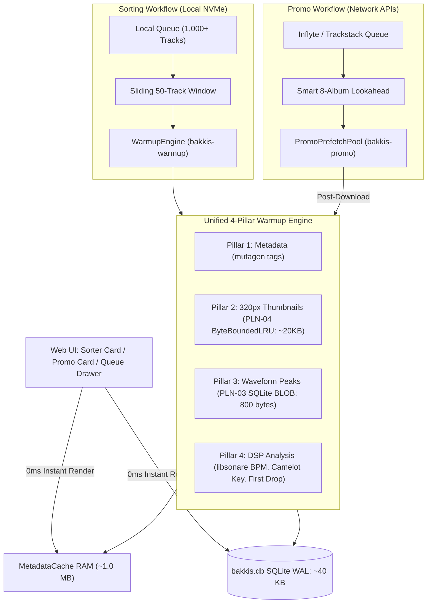

# PLN-06: Unified Lookahead Warmup Engine (Sorting & Promo Pipelines)

- **Feature ID**: PLN-06
- **Status**: Completed
- **Scope**: `bakkis_sorter/pipeline.py`, `bakkis_sorter/backend/__init__.py`, `bakkis_sorter/backend/library.py`, `bakkis_sorter/promos/session.py`, `tests/test_pipeline.py`
- **Target Test Markers**: `pytest -m pipeline -v` & `pytest -m promos -v`
- **Target Execution Speed**: < 0.80s
- **Sorting Lookahead**: 50 tracks ahead
- **Promo Lookahead**: Next 8–10 releases ahead (network-friendly)
- **Worker Policy**: Low-priority background thread pool (macOS QoS Utility / Background)
- **Author**: BAKKIS Core Team

---

## 1. Problem Statement & Motivation

Currently, track pre-warming is fragmented and leaves the user exposed to noticeable delays across both workflows:
1. **Shallow Local Cover Lookahead**:
   - `PREFETCH_AHEAD = 8` only prefetched covers for the first few tracks. Rapid scrolling or jumping through the sorting queue quickly hit cold disk reads.
2. **On-Demand Waveform Computation**:
   - Waveform peaks (`waveform.py`) are computed on-demand when `/peaks_get` is requested after a card mounts.
3. **On-Demand DSP Analysis Latency**:
   - `libsonare` BPM, Camelot harmonic key, and drop detection run on-demand when `api("meta")` or `track_meta()` is called. For complex tracks, this adds 50–150 ms of CPU latency on the main thread right as the card renders.
4. **Promo Prefetch Gap**:
   - In promo mode, `_prefetch_nearby()` downloads audio and artwork streams in the background, but **leaves DSP and waveform extraction untouched**. When the user swipes $\rightarrow$ or $\uparrow$ to an upcoming promo, the main thread runs `libsonare` on the spot, causing card swipe stutter.

---

## 2. Technical Objectives & Architecture



---

### 2.1 The 4-Pillar Track Warmup
For every track entering the lookahead window:
1. **Pillar 1: Metadata**: Reads tags via `mutagen` $\rightarrow$ cached in `MetadataCache._meta`.
2. **Pillar 2: Album Artwork**: Reads APIC frame, downsamples to 320×320 JPEG via `downsample_cover()` $\rightarrow$ cached in `MetadataCache._covers` (`ByteBoundedLRU`).
3. **Pillar 3: Waveform Peaks**: Computes 800-byte peaks via `waveform.compute()` $\rightarrow$ persisted directly into SQLite `waveform_peaks` as raw binary `BLOB` (PLN-03).
4. **Pillar 4: DSP Analysis**: Runs `analyzer.analyze_audio_file()` $\rightarrow$ cached in SQLite `track_analysis`.

When the user navigates or swipes to the track, **all 4 pillars resolve in < 0.01 ms** (RAM hit or single 4KB SQLite page hit).

---

### 2.2 Workflow-Specific Lookahead Policies

#### A. Local Sorting Workflow (50-Track Lookahead)
- **Window**: 50 tracks ahead in `session.queue`.
- **Tier 1 (Immediate Next 1–8 tracks)**: High concurrency for the immediate cards. All 4 pillars are processed concurrently.
- **Tier 2 (Tracks 9–50)**: Opportunistic background warmup for I/O pillars (1–3); heavier DSP analysis (Pillar 4) queues gracefully.
- **Queue Drawer Synergy**: Because 50 tracks are warmed in advance, opening the queue drawer displays **BPM and harmonic Camelot keys already populated** for the next 50 tracks.

#### B. Promo Review Workflow (8–10 Album Lookahead)
- **Window**: Track 1 of the next 8 albums + upcoming tracks in current album (respecting network bandwidth and rate limits).
- **Post-Download Pipeline**: The moment `_ensure_audio_cached()` finishes downloading an audio stream, the worker immediately executes `read_meta()` and waveform extraction in the background.
- **Result**: Swiping between promos is **100% hitch-free**—BPM, Camelot key, drop position, and waveform canvas are warm before the card appears.

---

### 2.3 Low-Priority Background Execution (Efficiency Core Pinning)
- Thread pool: `ThreadPoolExecutor(max_workers=3, thread_name_prefix="bakkis-warmup")`.
- Background threads run at lower OS priority (`os.setpriority(os.PRIO_PROCESS, 0, 10)` on macOS) so they execute on Apple Silicon Efficiency cores, leaving Performance cores 100% free for audio playback, WebKit rendering, and UI interactions.

---

## 3. Scale & Memory Benchmarks (50 Tracks Ahead)

| Resource | Per-Track Cost | 50 Tracks Total | Storage Location |
| :--- | :--- | :--- | :--- |
| **Pillar 1 (Metadata)** | ~200 bytes | **~10 KB** | `MetadataCache._meta` (RAM) |
| **Pillar 2 (Cover Thumbnail)** | ~20 KB | **~1.0 MB** | `ByteBoundedLRU` (RAM) |
| **Pillar 3 (Waveform Peaks)** | 800 bytes | **~40 KB** | SQLite `waveform_peaks` (DB BLOB) |
| **Pillar 4 (DSP Analysis)** | ~120 bytes | **~6 KB** | SQLite `track_analysis` (DB Table) |
| **Total Memory Footprint** | ~21 KB | **~1.06 MB RAM** | **Ultra-lean, zero GC pressure** |

---

## 4. Component Modifications Detail

### 4.1 New Module: `bakkis_sorter/pipeline.py`
Exposes `WarmupEngine`:
```python
LOOKAHEAD_WINDOW = 50
TIER1_WINDOW = 8

class WarmupEngine:
    def __init__(self, metadata_cache: MetadataCache, storage: Any, workers: int = 3) -> None:
        self.meta = metadata_cache
        self.storage = storage
        self._lock = threading.Lock()
        self._pool = ThreadPoolExecutor(max_workers=workers, thread_name_prefix="bakkis-warmup")
        self._inflight: set[str] = set()
        self._current_window: list[Path] = []

    def update_queue(self, paths: list[Path]) -> None:
        """Update active lookahead window and schedule warmup for new upcoming tracks."""
        window = paths[:LOOKAHEAD_WINDOW]
        with self._lock:
            self._current_window = window
        for i, p in enumerate(window):
            tier1 = i < TIER1_WINDOW
            self._schedule_one(p, tier1)

    def _schedule_one(self, path: Path, tier1: bool) -> None:
        p_str = str(path)
        with self._lock:
            if p_str in self._inflight:
                return
            self._inflight.add(p_str)
        self._pool.submit(self._warm_track, path, tier1)

    def _warm_track(self, path: Path, tier1: bool) -> None:
        try:
            # Pillar 1 & 2: Metadata and 320px Cover
            self.meta.get(path)
            self.meta.cover(path)

            # Pillar 3: Waveform Peaks BLOB
            digest = self.meta.peaks._digest(path)
            if digest and not self.storage.get_peaks_bytes(digest):
                raw = waveform.compute(path)
                if raw is not None:
                    self.storage.put_peaks_bytes(digest, raw)

            # Pillar 4: DSP Analysis (if tier1 or unanalyzed)
            file_hash = file_digest(path)
            if file_hash and not self.storage.get_analysis(file_hash):
                analysis = analyze_audio_file(path)
                self.storage.put_analysis(
                    file_hash=file_hash,
                    bpm=analysis.bpm,
                    musical_key=analysis.musical_key,
                    camelot_key=analysis.camelot_key,
                    drop_seconds=analysis.drop_seconds,
                    jump_delta=analysis.jump_delta,
                    confidence=analysis.confidence,
                )
        finally:
            with self._lock:
                self._inflight.discard(str(path))

    def shutdown(self) -> None:
        self._pool.shutdown(wait=False, cancel_futures=True)
```

### 4.2 Integration: `bakkis_sorter/backend/__init__.py` & `library.py`
- Initialize `self.warmup = WarmupEngine(self.meta, self.storage)` on `AppBackend`.
- In `_prefetch()`:
  ```python
  def _prefetch(self) -> None:
      s = self.session
      if s is None or getattr(s, "is_inflyte", False):
          return
      with s.lock:
          paths = [t.path for t in s.queue[:LOOKAHEAD_WINDOW]]
      self.warmup.update_queue(paths)
  ```
- Trigger `_prefetch()` on queue initialization, streaming batch appends, and after sort/skip operations.
- Clean shutdown on `backend.close()`.

### 4.3 Integration: `bakkis_sorter/promos/session.py`
In `_prefetch_nearby()`:
```python
def fetch_one(tr: InflyteTrack) -> None:
    try:
        cached_audio = self._ensure_audio_cached(tr.id, silent=True)
        self.cover(tr.id)
        # Post-download warmup: immediately calculate DSP analysis and waveform peaks
        if cached_audio and cached_audio.is_file():
            from ..metadata import read_meta, PeakStore
            read_meta(cached_audio)
            if self.storage is not None:
                digest = PeakStore(self.cache_dir, storage=self.storage)._digest(cached_audio)
                if digest and not self.storage.get_peaks_bytes(digest):
                    from .. import waveform
                    raw = waveform.compute(cached_audio)
                    if raw is not None:
                        self.storage.put_peaks_bytes(digest, raw)
    except (SessionError, RateLimitError, urllib.error.URLError, OSError) as exc:
        ...
```

---

## 5. Verification & Testing Plan

1. **Pipeline Unit Tests (`tests/test_pipeline.py`)**:
   - `test_warmup_engine_four_pillars`:
     - Provide audio tracks to `WarmupEngine`.
     - Verify metadata, cover, waveform BLOB, and DSP analysis are all populated in RAM and SQLite.
   - `test_warmup_engine_window_shifting`:
     - Feed queue of 60 tracks.
     - Verify tracks 0..49 are warmed, and track 50 is deferred until queue advances.
   - `test_warmup_engine_skip_cached`:
     - Verify already-cached tracks execute in < 0.001 ms without duplicate computation.
2. **Promo Prefetch Tests (`tests/test_promo_session.py`)**:
   - Verify post-download audio warmup populates `track_analysis` and `waveform_peaks`.
3. **Execution Markers**:
   - Fast marker: `pytest -m pipeline -v` in **< 0.80s**.
   - Full suite `pytest -q` (**100% pass**, all 265+ tests).
